# Credit risk & loan default

Predict the probability that a Lending Club loan defaults (PD) from what was known when it
was approved, then turn PDs into priced approve/decline decisions with reason codes,
fairness checks and stability monitoring. See [PLAN.md](PLAN.md) for the eight phases.

**Status:** all eight phases done: data and leakage audit, WoE scorecard, monotonic
LightGBM challenger, calibration with expected loss and an approval policy, SHAP
explanations with adverse-action reason codes and a fairness audit, a second,
**synthetic** thin-file track for Ethiopian mobile-money borrowers, reject inference on
7.4M rejected applications with population-stability monitoring, and a shipped API and
dashboard. See [MODEL_CARD.md](MODEL_CARD.md) and the
[model validation report](docs/validation_report.md).

**Try it** (Docker Desktop; [details](#ship-api-dashboard-and-docker-phase-8)):

```powershell
git clone https://github.com/kidusw/credit-risk && cd credit-risk
docker compose up --build      # dashboard http://localhost:8502   API http://localhost:8001/docs
```

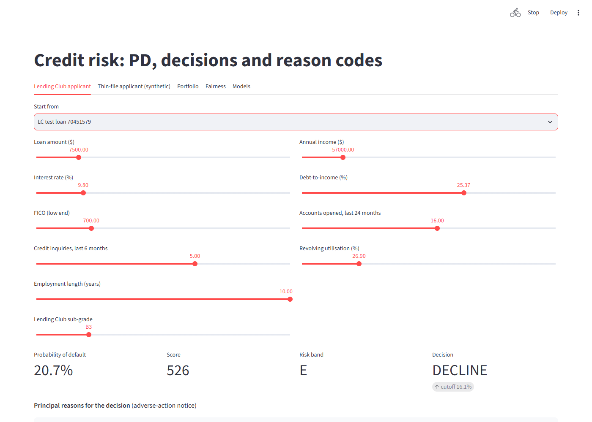

### Results (36-month loans, future vintages)

| Model | Valid AUC | Test AUC | Test Gini | Test KS |
|---|---:|---:|---:|---:|
| Lending Club sub-grade alone (baseline) | 0.669 | 0.684 | 0.368 | 0.269 |
| WoE scorecard, borrower data only | 0.661 | 0.670 | 0.340 | 0.245 |
| WoE scorecard + LC pricing | 0.681 | 0.693 | 0.386 | 0.280 |
| LightGBM (monotonic), borrower data only | 0.687 | 0.694 | 0.388 | 0.283 |
| **LightGBM (monotonic) + LC pricing (champion)** | **0.695** | **0.706** | **0.412** | **0.301** |

The champion was chosen on validation AUC. Details:
[Scorecard (Phase 2)](#scorecard-phase-2), [LightGBM challenger (Phase 3)](#lightgbm-challenger-phase-3),
[Calibration, expected loss and approval policy (Phase 4)](#calibration-expected-loss-and-approval-policy-phase-4),
[Explainability and fairness (Phase 5)](#explainability-and-fairness-phase-5). Every number
here is from the models without `addr_state`, which Phase 5 dropped.

**What the champion would have earned** on test (2015Q2–2016Q1), with every cutoff
chosen on validation: a capital-constrained lender approving the 66% of Lending Club's
loans with calibrated PD ≤ 16.1% earns **7.11% on the amount lent** ($199.8M), against
5.71% for the whole book and 6.67% for Lending Club's own best grade cutoff (A–B). Every
decline comes with up to four reason codes.

**Thin-file track (SYNTHETIC data, Phase 6):** the same pipeline scores 20,000
generated telebirr-style wallet users who have no credit-bureau file, using 24 features
built from their 12-month wallet history. On the held-out Q2 2025 cohort it reaches test
AUC 0.723, against 0.815 for the hidden rule that generated the labels and 0.618 for a
loan-to-inflow rule of thumb. The fairness audit by gender, region and urban/rural is in
[Thin-file track (Phase 6)](#thin-file-track-synthetic-mobile-money-phase-6). The labels
come from a rule written for this project, so these numbers show the method working,
**not real-world accuracy**.

## Data and licence

| | |
|---|---|
| Source | [Lending Club accepted loans 2007–2018Q4](https://www.kaggle.com/datasets/wordsforthewise/lending-club), Kaggle mirror of LendingClub's public loan downloads |
| File | `accepted_2007_to_2018Q4.csv.gz`, 393 MB compressed, 1.7 GB CSV, 2,260,668 loans × 151 columns |
| Licence | The Kaggle page lists **CC0-1.0**. The data itself was published by LendingClub, whose download page later added its own terms of use (the uploader notes this). So this project treats it as **research and demonstration use only**: the repository contains only the download script and aggregate statistics, never the raw or processed loan-level data. |

`data/` is git-ignored; run the pipeline below to recreate everything locally.

The Phase 6 track uses **synthetic data only**. It is generated by `crisk mm generate` with
seed 42, and no real customer or telebirr data is involved. Every borrower, transaction,
feature and `reports/mm_*.csv` row carries `source = synthetic`.

## Pipeline

```powershell
uv sync
copy .env.example .env            # add KAGGLE_API_TOKEN
docker compose up -d db           # PostgreSQL 16 on localhost:5434 (own compose project: crisk)
uv run crisk migrate
uv run crisk data download        # 393 MB, cached in data/raw/ (--rejected: +255 MB, Phase 7)
uv run crisk data build           # ingest (if needed) -> filters -> split -> schema check
uv run crisk data load            # matured loans + vintage table into Postgres
uv run crisk train scorecard      # Phase 2: WoE scorecards + baseline, logged to MLflow
uv run crisk train gbm            # Phase 3: monotonic LightGBM, tuned on validation, vs scorecards
uv run crisk decide               # Phase 4: calibration, expected loss, approval cutoffs
uv run crisk explain              # Phase 5: SHAP, reason codes, fairness, addr_state ablation
uv run crisk mm generate          # Phase 6: SYNTHETIC borrowers + wallet history + features
uv run crisk mm train             # Phase 6: scorecard, LightGBM, calibration, reasons, fairness
uv run crisk mm score 15001 15002 # Phase 6: PD, decision and reasons for synthetic borrowers
uv run crisk data rejected        # Phase 7: 27.6M rejected applications -> parquet (60 s)
uv run crisk monitor stability    # Phase 7: PSI by issue quarter, characteristic report
uv run crisk monitor reject       # Phase 7: reject inference (fuzzy, parcelling)
uv run pytest
```

| Step | Output | Time / memory on the 8 GB work laptop |
|---|---|---|
| `data ingest`: stream the CSV in 200k-row chunks, read only the 110 non-dropped columns, float32 numerics, append to parquet | `data/interim/accepted.parquet` (192 MB) | 50 s, peak RSS 308 MB |
| `data build`: label, matured-vintage filter, derived features, time split, Pandera check | `data/processed/model_table.parquet`, `outcomes.parquet`, `reports/*.csv` | 32 s, peak RSS 1.8 GB; model table 284 MB in memory |
| `data load`: truncate + COPY in one transaction (idempotent) | Postgres `loans` (779,026 rows), `vintages` (82 rows) | 26 s |
| `train scorecard`: two scorecards + baseline, evaluated per split, vintage, grade, term | `models/*.joblib`, `reports/scorecard_*`, `reports/iv_*`, MLflow runs (`mlflow.db`) | 107 s, peak RSS 1.2 GB |
| `train gbm`: 12-config random search per variant (early stopping on validation), all models re-scored, paired bootstrap | `models/gbm_*.joblib`, `reports/gbm_*`, `reports/model_*`, `reports/auc_by_vintage.png` | 11 min, peak RSS 1.3 GB |
| `decide`: calibrate on validation, loss and profit per vintage, cutoffs chosen on validation | `reports/calibration_*`, `reports/policies.csv`, `reports/profit_curves*`, `reports/reliability_test.png` | 75 s |

## Leakage audit

Every one of the 151 source columns is classified in
[`src/crisk/data/columns.py`](src/crisk/data/columns.py). Only **feature** (application
data, bureau attributes at application) and **pricing** columns reach the modelling table.
`tests/test_columns.py` fails if any column named as post-origination in the plan is a model
input. `tests/test_build.py` checks that the built table has exactly the audited columns. The
Pandera schema is `strict`, so an undeclared column fails validation. Ingest also refuses a
source file whose header differs from the audit.

**Pricing columns** (`grade`, `sub_grade`, `int_rate`, `installment`) are known at
approval, but they are Lending Club's own risk assessment. They are kept, and flagged, so
Phases 2–3 can report results with and without them (a model that leans on them mostly
re-learns Lending Club's grading).

Columns that are **not** model inputs, and why:

| Column | Role | Why it is not a model input |
|---|---|---|
| `id` | key | loan identifier |
| `member_id` | drop | empty in the public file |
| `funded_amnt` | exposure | amount issued; EAD for expected loss (Phase 4) |
| `funded_amnt_inv` | drop | investors' funding, decided after the application; near-copy of loan_amnt |
| `emp_title` | drop | free text job title, ~500k distinct values |
| `issue_d` | date | month the loan was issued |
| `loan_status` | target | outcome at the data cut; becomes the default label |
| `pymnt_plan` | drop | post-origination: payment plan put in place later |
| `url` | drop | listing URL, an identifier |
| `desc` | drop | free text, empty for almost every loan after 2013 |
| `title` | drop | free text loan title, duplicates purpose |
| `zip_code` | audit | 3-digit zip is a known proxy for race; kept only for the fairness audit |
| `fico_range_high` | drop | fico_range_low + 4 (+5 for 441 loans): redundant |
| `out_prncp`, `out_prncp_inv` | drop | post-origination: payment history after the loan was issued |
| `total_pymnt_inv`, `total_rec_late_fee`, `last_pymnt_amnt`, `next_pymnt_d` | drop | post-origination: payment history after the loan was issued |
| `total_pymnt`, `total_rec_prncp`, `total_rec_int`, `last_pymnt_d` | outcome | post-origination: payment history; kept for LGD and profit (Phase 4) |
| `recoveries`, `collection_recovery_fee` | outcome | post-origination: recovered after charge-off; kept for LGD |
| `last_credit_pull_d` | drop | post-origination: date of the latest bureau pull |
| `last_fico_range_high`, `last_fico_range_low` | drop | post-origination: FICO refreshed after issuance, falls as borrowers default |
| `policy_code` | drop | constant (1) in this file |
| `sec_app_fico_range_high` | drop | sec_app_fico_range_low + 4: redundant |
| `hardship_*` (12), `deferral_term`, `payment_plan_start_date`, `orig_projected_additional_accrued_interest` | drop | post-origination: hardship plan agreed after the borrower got into trouble |
| `debt_settlement_flag`, `debt_settlement_flag_date`, `settlement_*` (5) | drop | post-origination: debt settlement after charge-off |

(`uv run crisk data audit` prints the full, ungrouped table.)

Derived at build time: `term_months`, `emp_length_years`, `credit_history_months`
(issue date − earliest credit line) and the co-borrower equivalent. That leaves 99 features (95 application + 4 pricing) plus 5 meta columns
(id, issue_d, issue_quarter, split, default).

## Target and matured vintages

`default = 1` for *Charged Off*, *Default* and *Does not meet the credit policy.
Status:Charged Off*; `0` for *Fully Paid* (both variants). *Current*, *In Grace Period*
and *Late* loans are unresolved and excluded. Any other status fails the build.

The data cut is **March 2019** (the latest `last_pymnt_d`). A loan counts as matured when
`issue month + term ≤ 2019-03`, which means 36-month loans issued up to **2016Q1** and
60-month loans up to **2014Q1**.

| Filter | Rows left | Removed |
|---|---:|---:|
| Raw loans (33 summary lines at the end of the file dropped) | 2,260,668 | |
| Resolved (paid off / charged off) | 1,348,099 | 912,569 |
| Matured vintage | 779,026 | 569,073 |

### Why the matured filter matters

Default rate by issue year among resolved loans (count in brackets):

| Issue year | 36-month | 60-month |
|---|---|---|
| 2007 | 26.2% (603) | – |
| 2008 | 20.7% (2,393) | – |
| 2009 | 13.7% (5,281) | – |
| 2010 | 10.9% (9,156) | 22.4% (3,381) |
| 2011 | 10.6% (14,101) | 23.6% (7,620) |
| 2012 | 13.6% (43,470) | 27.7% (9,897) |
| 2013 | 12.3% (100,422) | 25.1% (34,382) |
| 2014 | 13.7% (162,570) | 31.1% (60,533) partly immature |
| 2015 | 14.9% (283,026) | 36.4% (92,520) immature |
| 2016 | 19.8% (232,361) partly immature | 36.4% (60,744) immature |
| 2017 | 20.0% (128,551) immature | 33.0% (40,770) immature |
| 2018 | 13.2% (41,272) immature | 22.6% (15,046) immature |

For immature vintages, "resolved" means "already resolved". That set is biased in both
directions: early charge-offs and early prepayers. The 2016–17 rates are inflated by early
defaults. The 2018 rates are deflated because most of those loans haven't had time to
default: 2018Q4 shows 2.6%. Quarterly detail is in
[`reports/vintages.csv`](reports/vintages.csv), and in the Postgres `vintages` table.

## Time split

Split by issue month. Boundaries are in `crisk.data.build.SPLITS`:

| Split | Issued | Loans | Defaults | Default rate | 60-month share |
|---|---|---:|---:|---:|---:|
| train | 2007-06 – 2014-06 | 315,600 | 48,981 | 15.5% | 21.6% |
| valid | 2014-07 – 2015-03 | 147,183 | 21,191 | 14.4% | 0% |
| test | 2015-04 – 2016-03 | 316,243 | 48,200 | 15.2% | 0% |

**Caveat:** 60-month loans issued after 2014Q1 haven't matured, so validation and test are
36-month loans only. Train keeps 60-month loans, with `term_months` as a feature: 36-month
default rate 12.8% in train vs 25.4% for 60-month. Headline metrics in later phases are
therefore for 36-month loans, and the per-term results are reported separately.

Default rate by Lending Club grade, per split ([`reports/default_rate_by_grade.csv`](reports/default_rate_by_grade.csv)):

| Grade | train | valid | test |
|---|---:|---:|---:|
| A | 5.7% | 5.5% | 5.4% |
| B | 11.0% | 11.3% | 12.2% |
| C | 17.6% | 18.1% | 20.1% |
| D | 22.8% | 23.8% | 27.3% |
| E | 28.6% | 29.9% | 34.4% |
| F | 34.1% | 32.1% | 42.8% |
| G | 36.9% | 36.9% | 48.4% |

The same grade got riskier over time, especially C–G in the test period. This is the drift a
model trained on older vintages has to survive, and why results are reported per vintage.

## Missingness

Per feature and split: [`reports/missingness.csv`](reports/missingness.csv). Two groups are
structurally missing in the matured window:

- **Joint applications** (`annual_inc_joint`, `dti_joint`, `sec_app_*`, `revol_bal_joint`):
  Lending Club started joint loans in late 2015, so these are 100% missing in train/valid and
  ≥ 99.5% in test.
- **Bureau fields added in late 2015** (`open_acc_6m`, `open_il_*`, `open_rv_*`, `il_util`,
  `all_util`, `inq_fi`, `total_cu_tl`, `inq_last_12m`, `mths_since_rcnt_il`, `total_bal_il`,
  `max_bal_bc`): 100% missing in train/valid, about 67% in test.

They stay in the table (they are legitimate application-time data), and Phase 2's feature
screening drops anything that is empty in train.

`dti` contains sentinel values (−1 and 999). The schema allows them, and Phase 2 cleans them.

## Database

Own Compose project (`name: crisk`) and port **5434**, so it runs alongside Project 1's
database on 5433. `loans` holds the loan-level facts (amounts, grade, purpose, outcome,
split, `source='lending_club'`). The full feature matrix stays in parquet. `vintages` is the
table above at quarter level. A `crisk_test` database is created on first start for the
integration tests.

## Scorecard (Phase 2)

A classic credit scorecard, built the way a bank would build one
([`src/crisk/models/scorecard.py`](src/crisk/models/scorecard.py)):

1. **Monotonic optimal binning** per feature with
   [optbinning](https://github.com/guillermo-navas-palencia/optbinning). Numeric features
   are constrained to a monotonic default-rate trend, with at most 8 bins and each bin at
   least 5% of train. Missing values get their own bin.
2. **Screening on information value (IV):** features with IV < 0.02 are dropped. Of any pair
   of WoE features with |correlation| > 0.7, the one with lower IV is dropped.
3. **Logistic regression on WoE.** A feature whose coefficient has the wrong sign (riskier
   bins scored as safer) is removed, and the model is refit until every sign is right.
4. **Points:** 600 points at 50:1 good:bad odds, and every 20 points doubles the odds. Each
   bin's points are rounded, so a score is just a sum of whole numbers.

Both variants are fitted on the same 315,600 train loans only:

- **with_pricing**: all application-time features plus Lending Club's grade, sub-grade,
  rate and installment. 18 features selected. `int_rate` and `grade` are dropped as
  near-duplicates of `sub_grade` (|corr| 0.97).
- **no_pricing**: borrower and bureau data only. 17 features selected.

The champion is chosen on **validation AUC** (with_pricing). Test was scored once.

### Results

| Model | Split | AUC | Gini | KS | PR-AUC | Brier | Mean PD | Default rate |
|---|---|---:|---:|---:|---:|---:|---:|---:|
| LC sub-grade baseline | valid | 0.669 | 0.338 | 0.250 | 0.232 | 0.1179 | 14.0% | 14.4% |
| | test | 0.684 | 0.368 | 0.269 | 0.262 | 0.1227 | 13.3% | 15.2% |
| Scorecard, no pricing | valid | 0.661 | 0.323 | 0.234 | 0.235 | 0.1184 | 13.6% | 14.4% |
| | test | 0.670 | 0.340 | 0.245 | 0.256 | 0.1237 | 12.9% | 15.2% |
| **Scorecard + pricing** | valid | **0.681** | **0.362** | **0.264** | **0.251** | **0.1171** | 13.5% | 14.4% |
| | test | **0.693** | **0.386** | **0.280** | **0.277** | **0.1221** | 12.8% | 15.2% |

The baseline gives each loan the train default rate of its Lending Club sub-grade.

Reading these honestly:

- **Lending Club's own grade is a strong baseline.** The borrower-only scorecard does
  *not* beat it (−0.014 test AUC). Lending Club priced loans with data we don't have:
  its full bureau file and its own models.
- **Combining both helps**, by +0.009 test AUC over the baseline. The gain sits *within*
  grades, where sub-grade alone can't rank. Test AUC within each grade (A–G) is 0.57–0.63
  for the scorecard against 0.47–0.60 for the baseline
  ([`reports/scorecard_by_grade.csv`](reports/scorecard_by_grade.csv)).
- **Test AUC is higher than validation AUC.** Later vintages are more spread out (the grade
  default rates diverge, see Phase 1), which makes ranking easier. It isn't a sign of a
  better model.
- **PDs drift low.** Mean predicted PD falls from 13.6% in 2014Q3 to 12.6% in 2016Q1, while
  the realised default rate rises from 13.6% to 16.1%. Ranking holds up, but calibration
  doesn't. That is Phase 4's job (recalibration on validation).
- 60-month loans exist only in train: AUC 0.640 there, against 0.672 for 36-month loans
  ([`reports/scorecard_by_term.csv`](reports/scorecard_by_term.csv)).

### Per vintage (test and validation quarters, AUC)

| Issue quarter | LC sub-grade | No pricing | + Pricing | Default rate | Mean PD (+ pricing) |
|---|---:|---:|---:|---:|---:|
| 2014Q3 (valid) | 0.657 | 0.664 | 0.678 | 13.6% | 13.6% |
| 2014Q4 (valid) | 0.676 | 0.660 | 0.684 | 14.5% | 13.6% |
| 2015Q1 (valid) | 0.673 | 0.661 | 0.681 | 14.8% | 13.4% |
| 2015Q2 (test) | 0.677 | 0.666 | 0.686 | 15.4% | 13.4% |
| 2015Q3 (test) | 0.681 | 0.671 | 0.692 | 14.6% | 12.9% |
| 2015Q4 (test) | 0.682 | 0.668 | 0.691 | 14.8% | 12.5% |
| 2016Q1 (test) | 0.694 | 0.675 | 0.700 | 16.1% | 12.6% |

Validation is 2014Q3–2015Q1, test 2015Q2–2016Q1. Full table: [`reports/scorecard_by_vintage.csv`](reports/scorecard_by_vintage.csv).

### The scorecard

Human-readable, bin → points:
[`reports/scorecard_with_pricing.md`](reports/scorecard_with_pricing.md), plus the CSV
and the no-pricing version. An excerpt:

| Feature | Bin | Default rate (train) | Points |
|---|---|---:|---:|
| sub_grade | A1–A4 | 4.9% | 50 |
| sub_grade | C1, C2 | 15.4% | 30 |
| sub_grade | E1–G5 | 30.6% | 16 |
| term | 36 months | 12.8% | 33 |
| term | 60 months | 25.4% | 20 |
| fico_range_low | < 672.5 | 20.3% | 28 |
| fico_range_low | ≥ 757.5 | 6.3% | 36 |
| loan_to_income | < 0.13 | 11.2% | 35 |
| loan_to_income | ≥ 0.39 | 24.7% | 21 |

Test scores run from 489 to 617, with a median of 546. Default rate falls steadily by score
decile, from 33.4% in the lowest decile to 3.3% in the highest.

IV for every candidate feature, and why each one was dropped:
[`reports/iv_with_pricing.csv`](reports/iv_with_pricing.csv). Of the borrower features,
`term_months` (0.136), `fico_range_low` (0.110) and `loan_to_income` (0.101) are
medium-strength. Everything else is weak (IV < 0.1). No feature reaches the
"suspiciously strong" level (IV > 0.5) that would point to leakage.

### Tracking

Every run is logged to MLflow (`mlflow.db`, git-ignored) under the experiment
`crisk-scorecard`, with parameters, per-split metrics, the points table and the IV table.
Browse with `uv run mlflow ui --backend-store-uri sqlite:///mlflow.db`.

## LightGBM challenger (Phase 3)

[`src/crisk/models/gbm.py`](src/crisk/models/gbm.py): LightGBM on every available
application-time feature, with **monotonic constraints** wherever the direction of risk is
settled credit practice:

- **PD can only go up** with term, rate, sub-grade, DTI, loan-to-income, utilisation,
  recent inquiries and new accounts, and derogatory marks.
- **PD can only go down** with FICO, income, credit history length, months since the
  latest inquiry or account, mortgages and the share of accounts never delinquent.

31 of the 70 features are constrained. The rest, such as purpose and balances, are left free.
Grade and sub-grade become ordinals (A1 = 0 … G5 = 34) so they can be constrained too. A
test fits the model and checks on predictions that a higher FICO never raises the PD and
a higher DTI never lowers it.

**Protocol:** a 12-configuration seeded random search per variant (leaves, minimum leaf
size, row and column sampling, L2). Each configuration is fitted on train, with early
stopping on validation AUC. The best validation AUC wins. Test was scored once, for every
model, after all choices were made. The search space is small and flat: validation AUC
ranges over 0.694–0.695 (with pricing) and 0.685–0.687 (without). The model isn't
sensitive to these settings, so a larger search isn't worth the laptop time. Results:
[`reports/gbm_tuning_*.csv`](reports/gbm_tuning_with_pricing.csv).

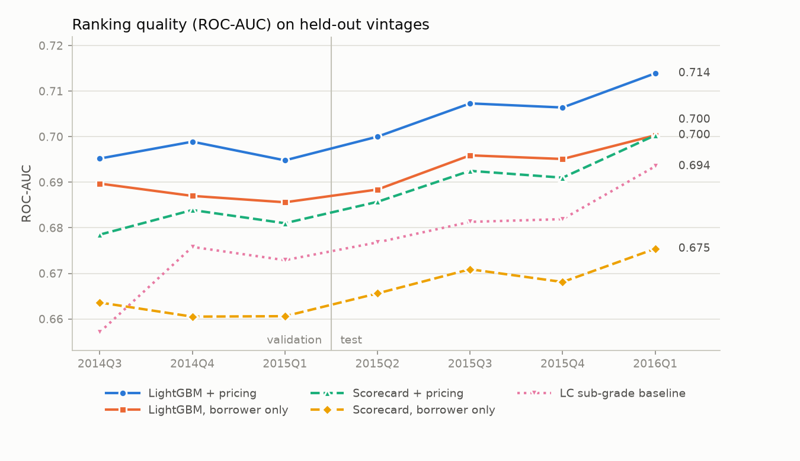

### Results

| Model | Split | AUC | Gini | KS | PR-AUC | Brier |
|---|---|---:|---:|---:|---:|---:|
| LC sub-grade baseline | valid | 0.669 | 0.338 | 0.250 | 0.232 | 0.1179 |
| | test | 0.684 | 0.368 | 0.269 | 0.262 | 0.1227 |
| Scorecard + pricing | valid | 0.681 | 0.362 | 0.264 | 0.251 | 0.1171 |
| | test | 0.693 | 0.386 | 0.280 | 0.277 | 0.1221 |
| LightGBM, borrower only | valid | 0.687 | 0.374 | 0.271 | 0.257 | 0.1166 |
| | test | 0.694 | 0.388 | 0.283 | 0.278 | 0.1216 |
| **LightGBM + pricing** | valid | **0.695** | **0.390** | **0.287** | **0.264** | **0.1161** |
| | test | **0.706** | **0.412** | **0.301** | **0.291** | **0.1210** |

**AUC lift with a 95% paired bootstrap interval** (200 resamples of the same loans for
both models; [`reports/model_lift.csv`](reports/model_lift.csv)):

| Challenger | vs | Valid lift | Test lift [95% CI] |
|---|---|---:|---|
| LightGBM + pricing | Scorecard + pricing | +0.014 | **+0.013** [0.012, 0.014] |
| LightGBM, borrower only | Scorecard, borrower only | +0.026 | **+0.024** [0.023, 0.026] |
| LightGBM + pricing | LC sub-grade | +0.026 | **+0.022** [0.021, 0.023] |
| LightGBM, borrower only | LC sub-grade | +0.018 | **+0.010** [0.008, 0.012] |

What this shows:

- **LightGBM beats the scorecard on every held-out vintage**, by a stable margin
  (chart above). This isn't one lucky quarter.
- **Borrower data alone now beats Lending Club's grade.** The scorecard couldn't (−0.014),
  but LightGBM can (+0.010, CI excludes zero). The extra signal is in interactions and
  non-linear shapes that a one-dimensional WoE transform throws away.
- **The gain is within grades**, where it matters for pricing. Test AUC within each grade
  A–G is 0.59–0.65 for LightGBM + pricing, 0.57–0.63 for the scorecard and 0.47–0.60 for
  sub-grade alone ([`reports/model_by_grade.csv`](reports/model_by_grade.csv)).
- **Calibration still drifts.** Mean predicted PD on test is 12.4% against 15.2% realised,
  slightly worse than the scorecard. Ranking is the model's job here; Phase 4 recalibrates
  on validation.

**What the trade-off costs:** the scorecard is 18 bins anyone can read and audit by hand.
LightGBM is 205 trees. Phase 5 (SHAP and reason codes) is what makes the champion
explainable to an applicant. A bank might still ship the scorecard and keep LightGBM as a
challenger. This project carries both forward.

### What drives it

Gain share for the champion ([`reports/gbm_importance_with_pricing.csv`](reports/gbm_importance_with_pricing.csv)):
`sub_grade` 27%, `int_rate` 9%, `grade` 8%, `loan_to_income` 6%, `annual_inc` 5%,
`term_months` 4%. Without pricing, `term_months`, `fico_range_low`, `loan_to_income` and
`annual_inc` lead. SHAP (Phase 5) gives a less gain-biased view.

**`addr_state` was dropped in Phase 5.** In the first Phase 3 model it was the
second-largest feature by gain (9%), although its IV was too low for the scorecard (0.011).
LightGBM's native categorical splits inflate gain on a 50-level feature, and a
validation-only ablation showed it was worth only 0.0012 AUC. Phase 5 applied a rule fixed
in advance and dropped it ([below](#should-state-be-in-the-model)). The tables above are
from the retrained models without it.

### Tracking

MLflow experiment `crisk-gbm`: one run per variant, with the chosen hyperparameters, the
best iteration, every metric, the AUC lifts, and the tuning and importance tables.

## Calibration, expected loss and approval policy (Phase 4)

[`src/crisk/models/calibration.py`](src/crisk/models/calibration.py),
[`src/crisk/decision/`](src/crisk/decision). This phase covers the champion (LightGBM +
pricing) and, for comparison, the scorecard + pricing, which is the model a bank would more
likely ship. **Every choice is made on validation:** the calibration method, the PD
cutoffs and the grade cutoffs. Test only reports what those choices would have earned.

### Calibration

Platt (a logistic fit on logit PD) and isotonic calibrators are both fitted on validation.
The method is picked by **5-fold cross-validation within validation** (out-of-fold Brier):
Platt for both models, by a hair (0.11589 vs 0.11592 for the champion). Both are then refitted on all of
validation.

| Champion | Split | Brier | ECE | Mean PD − default rate | Slope | Mean PD | Default rate |
|---|---|---:|---:|---:|---:|---:|---:|
| Raw | valid | 0.1161 | 0.0139 | −1.35 pp | 0.93 | 13.1% | 14.4% |
| Raw | test | 0.1210 | 0.0287 | −2.87 pp | 0.96 | 12.4% | 15.2% |
| **Platt** | valid | 0.1159 | 0.0047 | 0.00 pp | 1.00 | 14.4% | 14.4% |
| **Platt** | test | **0.1203** | **0.0161** | **−1.54 pp** | 1.04 | 13.7% | 15.2% |

ECE uses 20 equal-frequency bins. Slope is the coefficient of `y ~ logit(PD)`: 1 means
well spread. Full table, including isotonic and the scorecard:
[`reports/calibration_metrics.csv`](reports/calibration_metrics.csv).

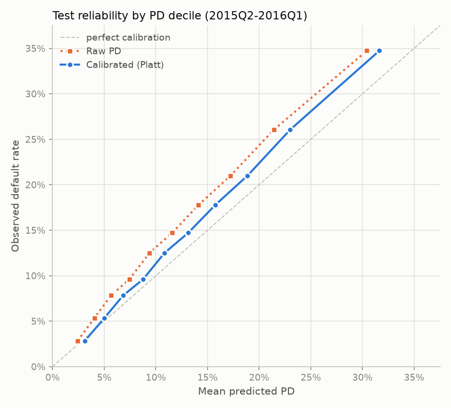

Calibration roughly **halves the test calibration error** and keeps the slope near 1, so
the ranking is untouched and the level is fixed. It can't fix everything. Validation is
calibrated almost perfectly, but test still under-predicts by 1.5 points, because the
book kept getting riskier after the calibration window (Phase 1's grade drift).

### Expected vs realised loss

**EL = PD × LGD × EAD.** EAD is the funded amount. LGD is the mean share of the funded
amount never recovered on charged-off **train** loans, by grade and term: from 0.48 (A,
36-month) to 0.68 (G, 60-month), in
[`reports/lgd_by_grade_term.csv`](reports/lgd_by_grade_term.csv). Realised loss is the
principal actually lost, net of recoveries. The outcome columns used here (payments,
recoveries) measure results and estimate LGD only. They are never model inputs.

| Issue quarter | Default rate | Mean PD (calibrated) | Realised loss | EL ÷ realised (raw) | EL ÷ realised (calibrated) |
|---|---:|---:|---:|---:|---:|
| 2014Q3 (valid) | 13.6% | 14.4% | $34.4M | 0.97 | 1.07 |
| 2014Q4 (valid) | 14.5% | 14.5% | $44.6M | 0.92 | 1.02 |
| 2015Q1 (valid) | 14.8% | 14.3% | $53.6M | 0.88 | 0.97 |
| 2015Q2 (test) | 15.4% | 14.2% | $64.3M | 0.82 | 0.91 |
| 2015Q3 (test) | 14.6% | 13.8% | $70.0M | 0.85 | 0.94 |
| 2015Q4 (test) | 14.8% | 13.3% | $86.1M | 0.78 | 0.86 |
| 2016Q1 (test) | 16.1% | 13.7% | $108.1M | 0.70 | 0.77 |
| **Test total** | 15.2% | 13.7% | **$328.5M** | 0.78 | **0.86** |

Over the whole validation window, expected loss matches realised loss (1.01 calibrated).
On test it covers 86%, falling to 77% by 2016Q1: **a model calibrated on yesterday's
vintages under-reserves when credit quality deteriorates.** A lender would need to watch
this (PSI and realised-vs-expected monitoring are Phase 7), not assume the calibration
holds. Per quarter: [`reports/expected_vs_realised_loss.csv`](reports/expected_vs_realised_loss.csv).

### Approval policy

**Realised profit** per loan = everything received (principal, interest, late fees,
recoveries) − collection fees − amount lent. It's undiscounted, with no servicing fee and
no cost of funds. Policies approve the lowest-PD share of applicants. Every loan in the
data was already approved by Lending Club, so these policies **decline a subset of LC's
book**, and "approve all" is LC's actual result.

Two lenders, two objectives, both optimised on validation:

- **Total profit** (capital is free and unlimited).
- **Return on the amount lent** (capital is the constraint).

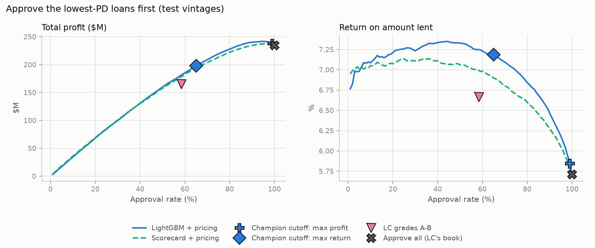

| Policy (cutoff chosen on validation) | Objective | Test approval | Lent | Profit | Return on lent | Bad rate |
|---|---|---:|---:|---:|---:|---:|
| Approve all (LC's book) | – | 100% | $4,108M | $234.6M | 5.71% | 15.2% |
| LC grades A–G (best grade cutoff) | profit | 100% | $4,108M | $234.6M | 5.71% | 15.2% |
| Champion PD ≤ 0.392 | profit | 99.1% | $4,072M | **$237.5M** | 5.83% | 15.0% |
| Champion: expected profit > 0 (untuned) | profit | 99.3% | $4,082M | $237.1M | 5.81% | 15.0% |
| LC grades A–B (best grade cutoff) | return | 58.4% | $2,480M | $165.3M | 6.67% | 9.3% |
| Scorecard PD ≤ 0.131 | return | 54.1% | $2,390M | $168.0M | 7.03% | 8.6% |
| **Champion PD ≤ 0.161** | return | 66.3% | $2,812M | $199.8M | **7.11%** | 9.6% |

Validation results and the scorecard's profit cutoff are in
[`reports/policies.csv`](reports/policies.csv); every choice is in
[`reports/decision_choices.csv`](reports/decision_choices.csv).

What the numbers say:

- **On total profit there is little to gain, judged on validation.** There, Lending
  Club's rates priced the risk: every grade A–G returned 4.7–8.8% as a block, so the best
  cutoff declines only the riskiest 1% (+$2.9M on test, +0.12 pp return). An untuned rule, "approve if (1 − PD) × good-loan return > PD ×
  bad-loan loss" with sub-grade margins from train, lands in the same place. That's a good
  sign the calibrated PDs are economically sensible.
- **Then the riskiest grades stopped paying.** On test, grades E, F and G *lost* money: −0.1%, −4.5% and
  −11.6% of the amount lent, against +4.7% to +8.8% on validation
  ([`reports/return_by_grade.csv`](reports/return_by_grade.csv)). They're small, 4% of
  test lending and a $1.6M loss, but the direction matters. That's why the test
  profit curve peaks nearer 95% approval, and why a cutoff tuned on validation leaves
  money on the table. Any policy fitted to the past inherits this risk. It's the strongest
  argument in this project for monitoring realised loss by vintage (Phase 7).
- **For a capital-constrained lender the model earns its keep.** At a similar approval
  rate, the champion's cutoff returns **7.11% vs 6.67%** for LC's grades A–B. It lends
  $332M more, makes **$34.5M more profit**, and has a similar bad rate (9.6% vs 9.3%).
  The scorecard's return cutoff sits in between (7.03%).
- **Approval rates drift with the PDs.** The cutoff approving 63% of validation approves
  66% of test, because test PDs are still slightly low (above). A production policy would
  monitor the approval rate and recalibrate.
- **Not modelled:** cost of funds, servicing fees, discounting, prepayment timing, and how
  declined applicants would have behaved (reject inference is Phase 7). These are
  comparisons between policies on the same book, not a forecast of absolute returns.

## Explainability and fairness (Phase 5)

[`src/crisk/explain/`](src/crisk/explain), run with `crisk explain`. The policy explained
and audited is Phase 4's capital-constrained lender: approve when the calibrated champion
PD is at or below 0.161, the cutoff chosen on validation. Lending Club's own grade cutoff
(A–B, a similar approval rate) is audited alongside as the reference.

### SHAP

Exact TreeSHAP from LightGBM's own `pred_contrib`, on the log-odds scale, for **every**
held-out loan (463k), not a sample: a decline needs its reasons. A test checks that each
row's contributions plus the base value add up to the model's logit.

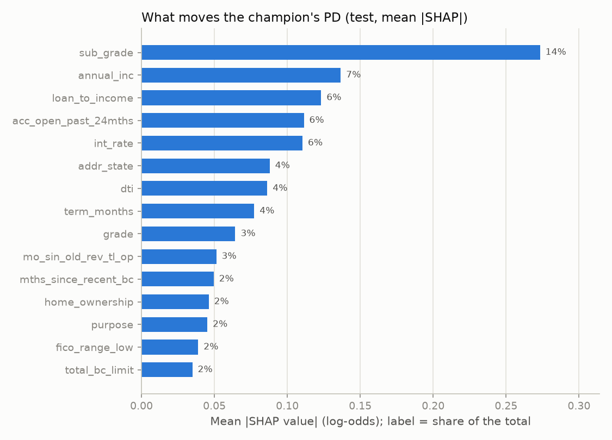

| Feature | Share of mean \|SHAP\| | Share of gain |
|---|---:|---:|
| `sub_grade` | 15.0% | 26.7% |
| `annual_inc` | 7.2% | 5.2% |
| `loan_to_income` | 6.2% | 6.1% |
| `int_rate` | 6.2% | 9.0% |
| `acc_open_past_24mths` | 5.7% | 3.2% |
| `dti` | 4.4% | 1.8% |
| `term_months` | 4.1% | 4.2% |
| `grade` | 3.7% | 8.3% |

Gain flatters the features the trees split on first. SHAP spreads the credit more
evenly: **borrower data (income, loan size relative to income, recently opened accounts,
DTI) carries more of the decision than gain suggests**, and Lending Club's grade less.
Full table: [`reports/shap_importance.csv`](reports/shap_importance.csv).

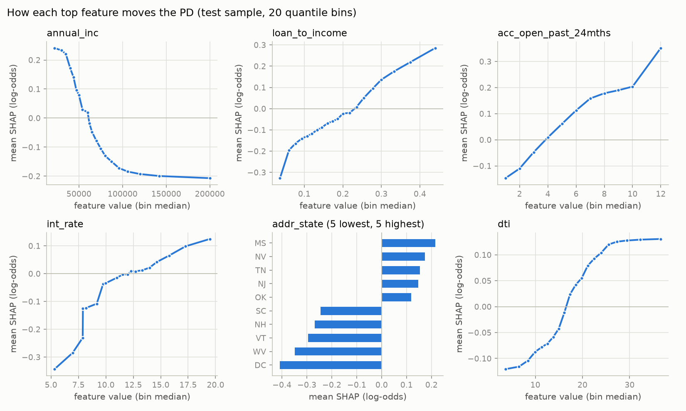

The dependence plots ([`reports/shap_dependence.csv`](reports/shap_dependence.csv)) show
the monotonic constraints at work: contributions rise steadily with DTI, loan-to-income
and recent accounts, and fall with income, flattening at the extremes (DTI above 25,
income above $100k). There are no jagged reversals.

### Adverse-action reason codes

Each of the 70 features belongs to exactly one of 19 plain-language reasons, such as
"Debt-to-income ratio too high" or "Too many recent credit inquiries"
([`reports/reason_code_map.csv`](reports/reason_code_map.csv)). A reason's weight for an
applicant is the sum of its features' SHAP values. Only reasons that pushed the PD **up**
can be stated, the largest first, at most four.

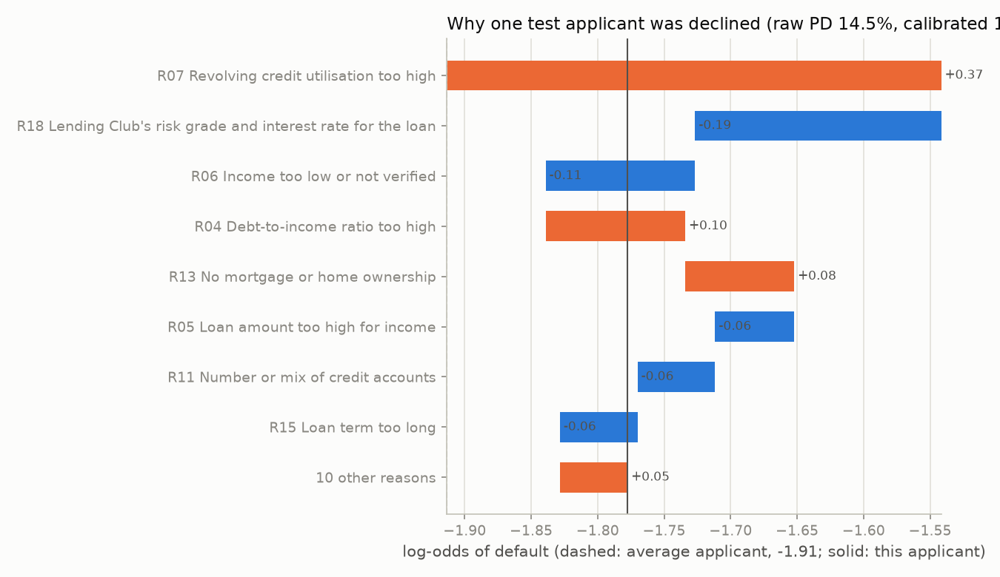

**Every one of the 161,156 held-out declines gets reasons:** four for all but four loans,
which had only three reasons pushing their PD up
([`reports/reason_counts.csv`](reports/reason_counts.csv)). A test asserts this. The most
common reasons on test declines:

| Reason | First reason | Among the top 4 |
|---|---:|---:|
| Lending Club's risk grade and interest rate (not actionable) | 60.1% | 84.2% |
| Too many accounts opened recently | 18.7% | 58.7% |
| Income too low or not verified | 6.2% | 50.6% |
| Loan amount too high for income | 6.1% | 39.3% |
| Debt-to-income ratio too high | 0.4% | 37.7% |
| Level of existing balances and credit limits | 1.3% | 20.5% |

**The honest weak spot:** for 60% of declines the top reason is Lending Club's own grade.
That's a true statement about this model, which leans on LC's pricing, but it tells the
applicant nothing they can act on. So the code is flagged `actionable=False`, and an
applicant still gets up to three borrower-level reasons behind it. A lender building its
own model, with no third-party grade as an input, would not have this problem. The
borrower-only LightGBM (test AUC 0.694) would be the model to explain to applicants.
Sample notices: [`reports/reason_codes_sample.csv`](reports/reason_codes_sample.csv).

### Fairness

Lending Club publishes **no sex, race or age**, so none of these is measured, and none is
inferred. What can be audited is state, home ownership, employment length and income band,
plus the 3-digit zip code. The zip code is a well-known proxy for race. It is kept out of
the model and used only here. Each attribute gets three views on test:

- **Adverse impact ratio (AIR):** a group's approval rate divided by the
  most-approved group's. US practice flags ratios below 0.8, the four-fifths rule.
- **True-positive-rate gap:** the approval rate among loans that were repaid, against the
  best group. This is equal opportunity.
- **Calibration by group:** mean PD minus default rate. If PDs are right within a group,
  a lower approval rate reflects higher risk, not a biased score.

| Attribute | Champion: lowest AIR (group) | Groups < 0.8 | LC A–B: lowest AIR | Groups < 0.8 | Max \|mean PD − default\| |
|---|---|---:|---|---:|---:|
| State (40 with ≥ 1,000 loans) | 0.81 (HI) | 0 | 0.79 (HI) | 1 | 5.8 pp |
| Home ownership | 0.75 (rent) | 1 | 0.83 (rent) | 0 | 2.3 pp |
| Employment length | 0.61 (missing) | 1 | 0.85 (missing) | 0 | 3.4 pp |
| Income band | **0.40 (< $40k)** | 2 | 0.55 (< $40k) | 2 | 2.5 pp |
| Zip3 (77 with ≥ 1,000 loans) | 0.65 (104xx) | 20 | 0.66 (104xx) | 12 | 5.1 pp |

Per group: [`reports/fairness_by_group.csv`](reports/fairness_by_group.csv). Summary:
[`reports/fairness_summary.csv`](reports/fairness_summary.csv).

What this shows:

- **The champion concentrates on income more than Lending Club's grades do.** It approves
  36% of applicants earning under $40k against 89% of those over $150k (AIR 0.40, vs 0.55
  for LC's grades). Among repaid loans the gap is 51 points. But the low-income group
  really does default more (20.5% vs 10.6%), and its PDs are calibrated almost exactly
  (−0.1 pp). The gap is risk the model measures, not a score biased against the group.
  It is still a policy choice, and a regulator would ask about it. Income is a
  legitimate credit factor, but a lender could cap the gap and pay for it in return.
- **Renters and applicants with no stated employment length are approved less** (AIR 0.75
  and 0.61). Both groups default more (18.2% and 22.1%), and their PDs are, if anything,
  slightly *low* (−2.3 and −3.4 pp). So the model isn't penalising them beyond their risk.
- **Almost every group's PDs are a little low** (mean PD below the default rate), because
  test is riskier than the calibration window (Phase 4). Home ownership, employment and
  income groups all err in that direction, within 3.4 pp. Calibration is loosest by state
  (−5.8 to +3.6 pp: some states are over-predicted, some under), one more sign that
  geography carries noise rather than signal.
- **Zip code is the proxy to watch.** Twenty of 77 large zip3 areas fall below 0.8 even
  though zip code isn't a model input. Geography reaches the model through income, DTI and
  credit history. That can't be fully removed. It can be monitored, which is what this
  table is for. Without race data, it can't be said whether those areas are
  disproportionately minority. This is stated, not worked around.

### Should state be in the model?

`addr_state` was the second-largest LightGBM feature by gain in Phase 3. The rule was fixed
**before** the ablation was run: geography is the textbook redlining proxy, state isn't
something an applicant can act on, and gain on a 50-level categorical is inflated. So state
stays only if it earns, **on validation**, at least +0.005 AUC or +0.10 pp return on the
amount lent at a re-chosen cutoff.

| Model | Valid AUC | Valid return | Test AUC | Test return | Test profit | State AIR (test) | States < 0.8 | Zip3 < 0.8 |
|---|---:|---:|---:|---:|---:|---:|---:|---:|
| With `addr_state` | 0.6958 | 8.58% | 0.7075 | 7.22% | $183.6M | 0.55 | 17 | 33 |
| **Without (champion)** | **0.6951** | **8.57%** | **0.7060** | **7.11%** | **$199.8M** | **0.81** | **0** | **20** |

Validation gain from state: **+0.0007 AUC and +0.01 pp return**, far short of the bar,
so **it is dropped** ([`reports/addr_state_ablation.csv`](reports/addr_state_ablation.csv)).
The first ablation, before the retrain, found +0.0012 and +0.05 pp and reached the same
decision. Test numbers were computed after the decision and played no part in it.

Dropping it costs 0.0015 test AUC. On test, the version with state earns a slightly
higher return on a smaller book (59% approved), while the champion makes $16M more
profit at 66%. The fairness gain is large: **state-level approval gaps shrink from
0.55 to 0.81 AIR, and no state now falls below the four-fifths line.** The number of
flagged zip3 areas drops from 33 to 20.

## Thin-file track: synthetic mobile money (Phase 6)

> **Synthetic data.** Every borrower, transaction and label in this section is generated
> by [`src/crisk/mobile_money/generate.py`](src/crisk/mobile_money/generate.py) (seed 42).
> The default labels come from a rule written for this project. This track shows the
> pipeline, the explanations and the fairness method on a realistic local use case. It
> says **nothing about how well wallet data predicts default in the real world**.

Most Ethiopian adults have no credit-bureau file, but many have a mobile-money wallet. A
lender offering small wallet loans has only the wallet history to judge them by. This
track builds that case end to end, with the same scorecard → LightGBM → calibration →
reason codes → fairness pipeline as the Lending Club model.
[`src/crisk/mobile_money/`](src/crisk/mobile_money); run with `crisk mm generate` (95 s)
and `crisk mm train` (45 s).

### The synthetic book

**20,000 borrowers** apply for a 90-day wallet loan between Jan 2024 and Jun 2025, more of
them each month as the product grows. Each has 360 days of wallet history before applying:
**5.9M transactions** of salary or sales receipts, agent cash-in and cash-out, airtime,
electricity and water bills, equb contributions and payouts, iddir, merchant payments and
P2P transfers. The structure follows Project 1's
[`SyntheticGenerator`](https://github.com/kidusw/transaction-categorization): a profile
per person first, then scheduled recurring flows, then Poisson-distributed discretionary
ones. It is rewritten vectorised, since Project 1's row-by-row loop would take too long
at this size.

**Generating assumptions**, all illustrative and none estimated from real data:

| Assumption | Value |
|---|---|
| Occupation | salaried, trader, farmer, day labourer, with separate urban and rural shares (half of rural borrowers farm) |
| Median monthly income | 14k / 11k / 7k / 5.5k ETB by occupation; ×1.25 urban, ×0.85 rural, **×0.85 for women** (an assumed pay gap, so the audit has a real difference to find) |
| Income regularity (latent) | high for salaried, medium for traders, low for farmers and day labourers. Farm income is seasonal (Oct–Jan harvest). Irregular earners also top up airtime less evenly and pay bills less punctually |
| Spending ratio (latent) | outflows ÷ inflows, N(0.93, 0.07). Above 1 the wallet drains |
| Buffer (latent) | the lowest balance the borrower keeps, in months of income |
| Income shock | 12% of borrowers lose 65% of one month's income in the last quarter |
| Equb / iddir | 35% / 55% members (+10 pts equb for women and traders, +15 pts iddir rural) |
| Loan | 0.3–1.6 × monthly income, 500–50,000 ETB; flat 9% fee; 75% lost on default |

**The hidden default rule** is a logit on the latent traits, never shown to the model:

| Driver | Term (log-odds) |
|---|---|
| Irregular income | 1.4 × (0.6 − regularity) |
| Volatility | 2.0 × (volatility − 0.3) |
| Overspending | 4.0 × (spending ratio − 0.93) |
| Thin buffer | −0.45 × ln(buffer months ÷ 0.3) |
| Loan size | 0.9 × (loan ÷ income − 0.9) |
| Income shock | 0.8 × shock |
| Social ties | −0.35 × equb − 0.2 × iddir − 0.6 × (social − 0.5) |
| Low income | −0.3 × ln(income ÷ 10,000) |

The rule also has an intercept of −2.75, a drift of +0.015 per application month (later
cohorts are riskier, and the model can't see why), and N(0, 0.8) noise. The overall
default rate is 12.8%. **Gender, region and urban/rural are not in the rule.** They are
generated so fairness can be measured, and they reach risk only through behaviour, such
as income level and seasonal farm income.

**Time split by application cohort:** train is 2024 (11,125 borrowers), validation is
Q1 2025 (4,219) and test is Q2 2025 (4,656, 13.7% default). As for Lending Club, every
choice is made on validation.

### Alternative-data features

[`features.py`](src/crisk/mobile_money/features.py) turns each wallet history into 24
features, using only transactions before the application. No latent trait, rule term or
demographic reaches the table, and a test checks this. Amounts are mostly scaled by the
borrower's own monthly inflow, so a trader and a clerk are compared on behaviour, not
size.

- **Income:** monthly inflow, its month-to-month CV, months with no inflow, and a recent
  dip (the worst of the last three months against the typical earlier month).
- **Income regularity**, using Project 1's recurring-payment detector, copied unchanged
  into [`recurring.py`](src/crisk/mobile_money/recurring.py): the share of earned inflow
  that arrives in a detected recurring series (same payer, regular interval, stable
  amount). It finds salaries (median 0.92 for salaried borrowers, 0 for traders and
  farmers). It also finds regular equb, iddir and bill payments, and recovers equb
  membership for every borrower in the book.
- **Cash flow and balance:** inflow ÷ outflow, lowest and mean balance ÷ inflow, days with
  a low balance, balance volatility and trend, cash-out share.
- **Behaviour:** airtime top-ups per month, the CV of the gaps between them, airtime
  share, regular bills, P2P contacts in and out, transactions per month.
- **Loan:** amount and loan ÷ monthly inflow.

The recent-dip feature was added after a first run, for a measurement reason. The
three-month average missed one-month shocks (0.7% of the model's weight against 8.2% of
the rule's). The dip feature left validation AUC unchanged (0.7166 vs 0.7169) and raised
the shock's share to 2.7%.

### Results

| Model (test = Q2 2025 cohort) | Valid AUC | Test AUC | Test KS | Test Brier |
|---|---:|---:|---:|---:|
| Rule of thumb: loan ÷ inflow (one-feature logistic) | 0.564 | 0.618 | 0.175 | 0.1164 |
| WoE scorecard (11 of 24 features kept) | 0.713 | **0.723** | 0.325 | 0.1093 |
| **Monotonic LightGBM (champion, 115 trees)** | **0.717** | **0.723** | **0.333** | **0.1093** |
| *Oracle: the hidden rule's own PD* | *0.796* | *0.815* | | |

Full tables: [`reports/mm_metrics.csv`](reports/mm_metrics.csv),
[`reports/mm_lift.csv`](reports/mm_lift.csv).

- **Wallet behaviour carries real signal.** Both models beat the rule of thumb by more
  than 0.10 AUC (95% CI [0.078, 0.126]). They recover about 70% of the lift that is
  achievable over random: the oracle's 0.815 is the ceiling, because the rule has noise
  and drift.
- **LightGBM and the scorecard tie** (test lift −0.000, CI [−0.007, 0.007]). LightGBM won
  validation by 0.004, inside the noise, so it is the champion by protocol. That's the
  expected answer here: the hidden rule is additive in log-odds, so a logistic scorecard
  is the right shape for it. A real lender should take the tie as a reason to ship the
  scorecard.
- **Calibration:** Platt, chosen by cross-validation within validation. On test the
  calibrated PDs under-predict by 0.75 pp (raw: 1.60 pp), with ECE 0.017 and slope 0.99.
  The gap comes from the drift built into later cohorts, the same pattern as Lending Club's
  test vintages.

**Approval policy** (profit-maximising cutoff chosen on validation; amounts in ETB):

| Policy (test cohort) | Approval | Lent | Profit | Return on lent | Bad rate |
|---|---:|---:|---:|---:|---:|
| Approve everyone | 100% | 49.2M | −0.43M | −0.87% | 13.8% |
| Rule of thumb (loan ÷ inflow) | 76.9% | 32.6M | 0.57M | 1.76% | 11.2% |
| Scorecard PD ≤ 0.122 | 58.2% | 33.0M | 1.16M | 3.51% | 7.5% |
| **Champion PD ≤ 0.085** | 39.8% | 23.0M | **1.23M** | **5.35%** | 5.1% |

At a 9% fee and 75% loss given default, **lending to everyone loses money**. The models
make it profitable. The champion's cutoff (PD ≤ 8.5%) sits below the break-even PD of
10.7%, but on validation the profit curve is flat between 38% and 56% approval
(1.01–1.07M ETB). Any cutoff in that band is defensible, and a lender wanting reach
would take the top of it. [`reports/mm_policies.csv`](reports/mm_policies.csv).

### Did the model find the hidden rule?

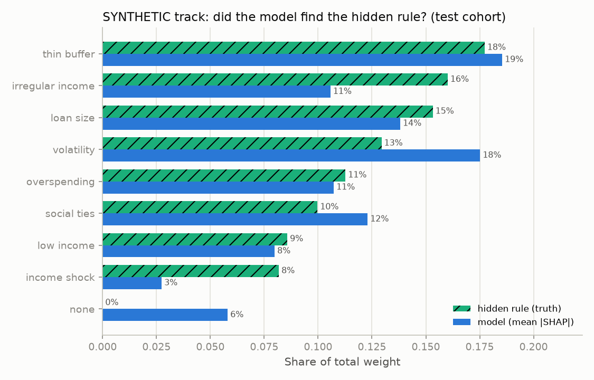

Each driver's true weight is the mean absolute deviation of its term in the rule. Its
model weight is the mean |SHAP| of the features that measure it, both as shares of the
total ([`reports/mm_rule_recovery.csv`](reports/mm_rule_recovery.csv)).

- **Buffer, loan size, overspending and low income are recovered within 2 points** of
  their true weight.
- **Volatility is over-weighted (18% vs 13%) and irregular income under-weighted (11% vs
  16%).** The two are correlated by construction, and farm seasonality makes a farmer's
  inflow look volatile even when the farmer's latent volatility is moderate. The model
  credits month-to-month CV for some of what regularity does.
- **The income shock is the hardest driver (3% vs 8%).** For an irregular earner, one bad
  month looks like an ordinary one.
- **6% of the weight sits on features that measure no driver**, such as airtime volume and
  bill counts. They correlate with income level and urban living, so the model uses them
  as proxies.

Top features by |SHAP|: inflow CV 16%, loan ÷ inflow 12%, lowest balance ÷ inflow 10%,
monthly inflow 8%, airtime-gap CV 7%, equb membership 7%
([`reports/mm_shap_importance.csv`](reports/mm_shap_importance.csv)).

### Reason codes

Ten plain-language reasons cover the 24 features
([`reports/mm_reason_code_map.csv`](reports/mm_reason_code_map.csv)), all of them
actionable or at least explainable to the borrower, with no third-party grade among them.
**All 5,420 held-out declines get reasons:** four for all but 95, which had only two or
three pushing their PD up. The most common first reasons on test: "income varies a lot
from month to month" (35%), "wallet balance often low" (28%), "loan amount high compared
with wallet inflows" (16%). Sample notices:
[`reports/mm_reason_codes_sample.csv`](reports/mm_reason_codes_sample.csv). The saved
bundle (`models/mm_model.joblib`) scores new rows with the same reasons:

```text
$ uv run crisk mm score 15001 15003
 borrower_id     pd decision                 reason_1                                reason_2 ...
       15001 0.1483  decline Wallet balance often low Income varies a lot from month to month ...
       15003 0.0612  approve                      NaN                                     NaN ...
```

### Fairness by gender, region and urban/rural

Approval-rate ratios (AIR) and calibration on the test cohort, for the champion's policy and
for the rule of thumb. Groups have at least 200 borrowers. The reference group (AIR 1.00) is
the most-approved one under each policy. Full tables:
[`reports/mm_fairness_by_group.csv`](reports/mm_fairness_by_group.csv),
[`reports/mm_fairness_summary.csv`](reports/mm_fairness_summary.csv).

| Group | Default rate | Mean PD | Champion approval | Champion AIR | Rule of thumb AIR |
|---|---:|---:|---:|---:|---:|
| Women | 13.7% | 13.0% | 40.5% | 1.00 | 1.00 |
| Men | 13.8% | 13.0% | 39.2% | 0.97 | 0.99 |
| Urban | 10.1% | 10.0% | 53.9% | 1.00 | 1.00 |
| Rural | 16.9% | 15.5% | 27.6% | **0.51** | 0.98 |
| Addis Ababa (champion's reference) | 10.1% | 10.1% | 53.9% | 1.00 | 0.96 |
| Lowest region: Afar (n = 257) | 12.5% | 14.9% | 29.6% | **0.55** | 0.89 |
| Salaried (champion's reference) | 7.2% | 6.3% | 75.9% | 1.00 | 0.99 |
| Farmers | 20.3% | 19.1% | 11.7% | **0.15** | 0.94 |

What the audit shows:

- **No gender gap**, although women's incomes were generated 15% lower. Women in this book
  are also more often traders and equb members, which the rule rewards, so their default
  rate equals men's and so does their approval rate. The model doesn't see gender, and a
  proxy-driven gap didn't appear.
- **A large rural and farmer gap, and it reflects real risk.** Rural borrowers default
  more (16.9% vs 10.1%), and farmers most of all (20.3%). Their PDs are, if anything,
  slightly *low*: −1.3 pp rural, −1.2 pp for farmers. So the model isn't penalising them
  beyond their risk. It does approve only 12% of farmers, and 6 of 8 regions fall below
  the four-fifths line against Addis Ababa. A regulator or a lender with an inclusion
  mandate would see that first.
- **The rule of thumb looks fair because it barely discriminates.** Every group is
  approved at 73–82%, but on test it makes half the champion's profit, with more than
  twice its bad rate. Equal approval rates are not the same as fair treatment: the rule
  approves risky borrowers as freely as safe ones.
- **Small-region calibration is noisy.** Afar is over-predicted by 2.5 pp and Somali
  under-predicted by 3.9 pp, on 230–260 borrowers each, about ±2 pp of sampling error.
  There's no pattern to fix, but a live model would watch this by region.
- **What a lender could do about farmers:** price for the risk instead of declining (a
  higher fee, or a smaller first loan that builds a history), or time repayment around
  the harvest. Seasonality is a schedule, not a habit. This track measures the gap and
  states the trade-off; it doesn't pick a fairness constraint.

### Serving

`models/mm_model.joblib` holds the champion, its Platt calibrator, the cutoff, the
feature list and the reason map. `crisk mm score` uses it today, next to the Lending
Club model's `models/decision.joblib`. Phase 8 puts both behind one `POST /score` API.

## Reject inference and stability (Phase 7)

[`src/crisk/monitor/`](src/crisk/monitor). Back to the Lending Club data: two questions a
model-risk reviewer asks about any credit model. *Does it hold up as the population
changes?* And *what about the applicants it never saw?*

### Population stability by vintage

[`stability.py`](src/crisk/monitor/stability.py) computes the **PSI** of both scores and the
champion's key features for every issue quarter, against train: Σ (actual% − expected%) ×
ln(actual% ÷ expected%). The bins are train deciles; missing values get their own bin;
categoricals and two-valued numerics are binned by value. Bands: **< 0.1 stable,
0.1–0.25 monitor, > 0.25 act**.

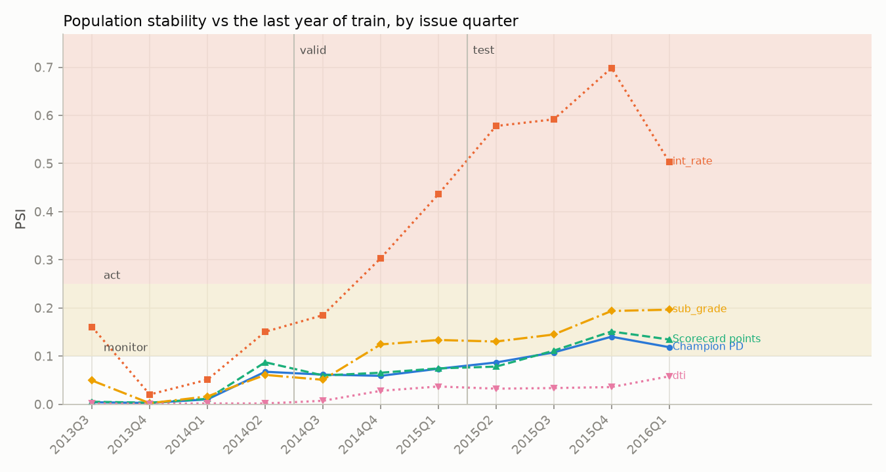

| Variable | Max PSI, valid | Max PSI, test (quarter) | Band | Test max vs last year of train |
|---|---:|---:|---|---:|
| Champion PD | 0.085 | 0.155 (2015Q4) | monitor | 0.140 |
| Scorecard points | 0.059 | 0.127 (2015Q4) | monitor | 0.151 |
| `int_rate` | 0.342 | **0.563** (2015Q4) | **act** | **0.698** |
| `sub_grade` | 0.123 | 0.174 (2015Q4) | monitor | 0.196 |
| `dti` | 0.060 | 0.085 (2016Q1) | stable | 0.058 |
| `loan_to_income` | 0.027 | 0.039 | stable | 0.052 |
| `fico_range_low` | 0.060 | 0.036 | stable | 0.007 |
| `annual_inc`, `home_ownership`, `purpose` | ≤ 0.05 | ≤ 0.054 | stable | ≤ 0.021 |
| `acc_open_past_24mths` | 1.217 | 1.244 | *artefact* | 0.043 |
| `term_months` | 1.712 | 1.712 | *by design* | 1.663 |

Every quarter: [`reports/psi_by_quarter.csv`](reports/psi_by_quarter.csv) (vs all of
train) and [`reports/psi_vs_recent_train.csv`](reports/psi_vs_recent_train.csv) (vs
2013Q3–2014Q2). Summary: [`reports/stability_summary.csv`](reports/stability_summary.csv).

Two of the red flags are false alarms, and a monitoring report has to say so:

- **`acc_open_past_24mths`** didn't exist before 2012Q2, so 16% of train is missing and no
  later loan is. Against the last year of train its PSI is 0.04, stable. The second
  reference window is there to separate field changes from population changes.
- **`term_months`** is 36 months only in validation and test, because 60-month loans from
  those windows hadn't matured. That's how the split was built, not drift.

The real finding: **Lending Club repriced, and the score drifted with it.** Interest rates
moved far more than grades (PSI 0.70 vs 0.20 by 2015Q4). The test book holds more A
grades (25% vs 17% in train) at lower rates (median 11.0% vs 13.7%). The champion reads
both as lower risk, so its score moves into the monitor band from 2015Q3.

**The characteristic stability report** ([`reports/csr_by_quarter.csv`](reports/csr_by_quarter.csv))
breaks the scorecard's average score into its 18 characteristics. By 2016Q1 the average
applicant scores **+7.1 points** above train, which is "safer". About +3.0 of that comes
from `sub_grade` and +3.0 from `term` (the 36-month-only design); the rest is under a point
each ([`reports/csr_latest_quarter.csv`](reports/csr_latest_quarter.csv)). Yet the 2016Q1
default rate was 16.1%, above train's 15.5%.

**Scores alone would have missed this.** Input stability says the book looked better.
Outcome monitoring (Phase 4) says expected loss covered only 77% of realised loss in
2016Q1. A monitoring plan needs both: PSI of scores and inputs every month, plus realised
vs expected loss as vintages season. Here the trigger is the repricing (`int_rate` in the
act band), and the action is to recalibrate on recent vintages and re-check whether
grades still mean what they meant in train.

### Reject inference

Lending Club approved only **12% of applications** in these windows. The other 88% are in
its rejected file (27.6M rows; 7.4M fall inside the train/valid/test windows). Every model
so far learned the risk of *approved* applicants. Reject inference guesses what the
rejected ones would have done and refits on everyone
([`reject.py`](src/crisk/monitor/reject.py)).

**The shared columns are thin.** The rejected file has only loan amount, risk score, DTI,
employment length, state and zip:

- State and zip stay out, as in Phase 5.
- Employment length is "< 1 year" for most rejects, against a median of 6 years for accepts.
  That looks like a field default rather than real tenure, so it's left out too.
- The model uses **FICO / risk score, DTI and loan amount**. Lending Club's data dictionary
  describes the reject risk score as FICO before 5 Nov 2013 and VantageScore after. The
  two scales are similar but not identical, which is one more caveat.

**Most rejects are policy rejects.** Their risk score is below 660 (Lending Club's floor:
no accepted loan has less) or missing, their DTI is over 40, or the amount is outside
1,000–35,000. No model trained on accepted loans has data there, so they aren't inferred:
they stay declined. In the test window about 90% of reject risk scores are missing, so only 2%
of test rejects are in range.

| Window | Accepted (all terms) | Rejected | LC approval rate | Policy rejects | In-range rejects |
|---|---:|---:|---:|---:|---:|
| Train (2007–2014Q2) | 333,475 | 2,305,007 | 12.6% | 1,632,346 (71%) | 672,661 |
| Valid (2014Q3–2015Q1) | 217,147 | 1,707,168 | 11.3% | 1,379,664 (81%) | 327,504 |
| Test (2015Q2–2016Q1) | 470,705 | 3,393,541 | 12.2% | 3,318,587 (98%) | 74,954 |

In-range rejects are weighted so that rejects : accepts matches Lending Club's real ratio
in each window ([`reports/reject_population.csv`](reports/reject_population.csv)).

**Three models**, all monotonic LightGBM on the same three columns:

1. **Known-good-bad (KGB):** accepted loans only.
2. **Fuzzy augmentation:** each in-range train reject enters twice, as bad with weight
   PD_KGB and as good with weight 1 − PD_KGB.
3. **Parcelling:** rejects are banded by KGB PD into deciles and labelled bad at **2×** the
   accepted bad rate of their band ([`reports/reject_parcel_bands.csv`](reports/reject_parcel_bands.csv)).
   The factor is an assumption: rejects in a band are taken to be riskier than accepts,
   because Lending Club saw more than these three columns.

| Model | Test AUC on accepted loans | Mean PD, accepted (test) | Mean PD, in-range rejects (test) | Decisions changed vs KGB (valid / test) |
|---|---:|---:|---:|---:|
| KGB (accepted only) | 0.623 | 15.8% | 16.7% | – |
| Fuzzy augmentation | 0.624 | 15.9% | 16.7% | 2.0% / 1.9% |
| Parcelling (2×) | 0.618 | 25.7% | 28.6% | 11.9% / 8.1% |

Decisions are compared at Lending Club's own approval volume. Each model approves as many
applicants as LC did, choosing the lowest PDs among accepted loans plus in-range rejects.
Policy rejects are declined by every model. Full tables:
[`reports/reject_models.csv`](reports/reject_models.csv),
[`reports/reject_decisions.csv`](reports/reject_decisions.csv),
[`reports/reject_flips.csv`](reports/reject_flips.csv),
[`reports/reject_fixed_cutoff.csv`](reports/reject_fixed_cutoff.csv).

What the numbers say:

- **On these three columns, in-range rejects look like accepts.** Their PD under the KGB is
  almost the same (16.7% vs 15.8% on test), and the KGB score's PSI between the two
  groups is 0.04. They do differ on DTI and loan amount (PSI 0.15–0.30;
  [`reports/reject_psi.csv`](reports/reject_psi.csv)), but not in ways that move the
  score. So Lending Club rejected them for information that isn't in the rejected file:
  full credit history, income verification, fraud checks. A model with only these
  columns can't reproduce LC's decision. At LC's volume in validation, it would give
  **65% of approval slots to applicants LC rejected**.
- **Fuzzy augmentation changes almost nothing** (2% of decisions, the same AUC). That is
  expected. Weighting each reject by the KGB's own PD adds no information: the refit
  learns the KGB back.
- **Parcelling changes decisions because of its assumption.** Doubling the band bad rates
  raises every PD (mean 25.7% against a real 15.2% on accepted test loans), so it is
  badly calibrated unless refitted. It shifts approvals back toward accepted applicants
  (59% of validation slots to rejects, down from 65%) and costs 0.005 AUC on the loans
  where outcomes are known. At the KGB's own PD cutoff it approves almost no one
  (0% valid, 29% test, against 40% and 86%). That's the "approval-rate change from
  reject inference", and it is set entirely by the inflation factor.
- **None of this can be validated.** Whether a rejected applicant would have repaid is
  unknowable from this data. The only measurable effect is on accepted loans, where
  reject inference can't help and here slightly hurts. The honest use of reject
  inference is as a *sensitivity analysis*: how much would decisions change under a
  stated assumption about rejects? The answer here is 2% under fuzzy augmentation and
  8–12% under parcelling at 2×. The real fix is data, through a small randomised
  approval test below the cutoff, which is how lenders actually measure it.

## Ship: API, dashboard and Docker (Phase 8)

[`src/crisk/serve/`](src/crisk/serve), [`src/crisk/dashboard/`](src/crisk/dashboard),
[`Dockerfile`](Dockerfile), [`docker-compose.yml`](docker-compose.yml). Documentation:
[MODEL_CARD.md](MODEL_CARD.md) and the [model validation report](docs/validation_report.md),
written in the format banks use: conceptual soundness, performance, stability,
limitations and a monitoring plan, with six findings.

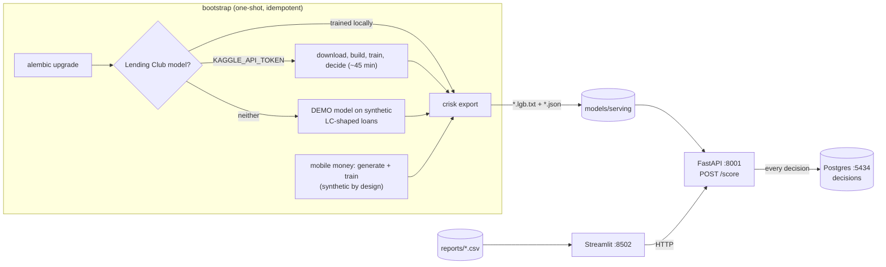

### Run it

```powershell
docker compose up --build
#   dashboard  http://localhost:8502
#   API docs   http://localhost:8001/docs
# Behind a TLS-intercepting proxy, pass its CA bundle as a BuildKit secret:
#   $env:CRISK_CA_BUNDLE = "C:\path\to\corporate-bundle.pem"; docker compose up --build
```

The bootstrap service runs once, then the API and dashboard start. Per track it uses
the first option that applies:

1. The model is already exported.
2. It was trained locally, so it is exported.
3. A Kaggle token is set, so the real pipeline runs.
4. Neither, so Lending Club gets a **DEMO** model trained on synthetic Lending-Club-shaped
   loans. The real loan data can't ship with the repository, so a fresh clone can't
   have the real model.

The mobile-money track is always generated, because it is synthetic by design. Demo and
synthetic answers say `"synthetic": true`, and the dashboard shows a banner. Ports
(8001, 8502, 5434) differ from Project 1's, so both stacks run side by side. Override
them with `CRISK_API_PORT`, `CRISK_DASHBOARD_PORT` and `CRISK_DB_PORT`.

Without Docker: `uv run crisk export`, `uv run uvicorn crisk.serve.app:app --port 8001`
and `uv run streamlit run src/crisk/dashboard/app.py`.

### The API

| Endpoint | What it does |
|---|---|
| `POST /score` | `{"track": "lending_club" \| "mobile_money", "applicant": {...}, "applicant_ref": "..."}` returns calibrated PD, points, risk band, decision, cutoff, up to 4 reasons and the missing features. The answer is logged to Postgres |
| `GET /model` | per track: version, training data, `synthetic`/`demo` flags, cutoff and its rule, test metrics, score scale, bands, reason map |
| `GET /examples/{track}` | sample applicants (the dashboard's starting points) |
| `GET /decisions?limit=20` | the latest decisions from the audit log |
| `GET /health` | tracks loaded, database reachable |

```text
POST /score  {"track": "mobile_money", "applicant": {"inflow_monthly": 6000, "inflow_cv": 0.9,
              "loan_amount": 9000, "loan_to_inflow": 1.5, "balance_min_to_inflow": 0.05}}
-> {"synthetic": true, "pd": 0.488, "score": 488, "risk_band": "F", "decision": "decline",
    "cutoff": 0.085, "reasons": [{"code": "M04", "text": "Wallet balance often low", ...},
    {"code": "M05", "text": "Loan amount high compared with wallet inflows", ...}, ...],
    "missing_features": ["months_without_inflow", ...], "decision_id": 1}
```

- **Outputs:**
  - **Points** use the scorecard's scale: 600 points means 50:1 good:bad odds, and every
    20 points doubles the odds.
  - **Risk bands** are A < 5%, B < 10%, C < 15%, D < 20%, E < 30% and F, on calibrated PD.
  - **Reasons** are given for declines only: exact TreeSHAP from the served booster,
    grouped into the same plain-language codes as Phases 5 and 6.
- **Safe artefacts.** `crisk export` writes each champion as LightGBM's own text format
  (which keeps the category mappings) plus a JSON file with the encoding, calibrator
  parameters, cutoff, bands, reason map and metrics. The API loads nothing with pickle.
  **Served PDs equal the training pipeline's exactly** (max difference 0.0 on 2,000 LC
  test loans and 1,000 synthetic borrowers), and a test asserts it to 1e-9.
- **Inputs:** features by model name. Unknown names are rejected (422). Missing ones
  become missing values, as in training, and are listed in the response. For Lending
  Club the API derives `loan_to_income` and cleans DTI sentinels, as `features.clean`
  does.
- **Audit trail:** every answer is written to the `decisions` table (Alembic migration
  0002) with the inputs, PD, score, band, reasons and model version. If Postgres is down,
  scoring still answers, with `decision_id: null`.

### Images

| Image | Contents | Size (unpacked / compressed) |
|---|---|---:|
| `crisk-api` | FastAPI, LightGBM, SQLAlchemy, pandas; no training code | 780 MB / 177 MB |
| `crisk-dashboard` | Streamlit + httpx only | 784 MB / 179 MB |
| `crisk-bootstrap` | + optbinning, MLflow, pyarrow, Kaggle client | 1.8 GB / 411 MB |

One two-stage Dockerfile builds all three. uv installs into a venv in the builder stage,
and the runtime stage copies only the venv and the code, plus `libgomp1` for LightGBM.
The corporate CA bundle is mounted as a BuildKit secret only while dependencies
download, so it is never in a layer. In the API image, scipy (a LightGBM dependency) and
pandas are most of the 446 MB venv.

### Validation

Validated end to end on the 8 GB work laptop (Docker Desktop, 3.9 GB for the VM):

- **Fresh clone, no Kaggle token**, cloned into an empty folder with
  `docker compose -p crisk-fresh up --build` on spare ports: **26 min 40 s** to a working
  stack.
  - About 21 minutes is building the three images from a cold cache, behind a
    TLS-intercepting proxy at 1 MB/s.
  - The bootstrap took **4 min 43 s**: migrate; train and export the demo Lending Club
    model; generate 20,000 synthetic borrowers (5.9M transactions); train the thin-file
    pipeline; export.
  - It reproduced the committed thin-file results exactly (test AUC 0.7227, seeded).
  - `/health` reported both tracks and the database. `/model` flagged the Lending Club
    model `demo: true`. `/score` answered and logged, and the dashboard served on its port.
- **This machine, real models:** after `crisk export`, the bootstrap only migrates and
  finds both tracks exported. The API serves the real champion (test AUC 0.706), and
  the dashboard at http://localhost:8502 drives it.
- **Tests:** 90 pass in CI and locally (10 new in `tests/test_serve.py`). They cover
  export → serving parity, the `/score` contract (decision vs cutoff, at most 4 positive
  reasons on declines, none on approvals), unknown-feature rejection, derived inputs,
  the score scale and bands, decision logging, scoring with the database down, and the
  dashboard's API client.

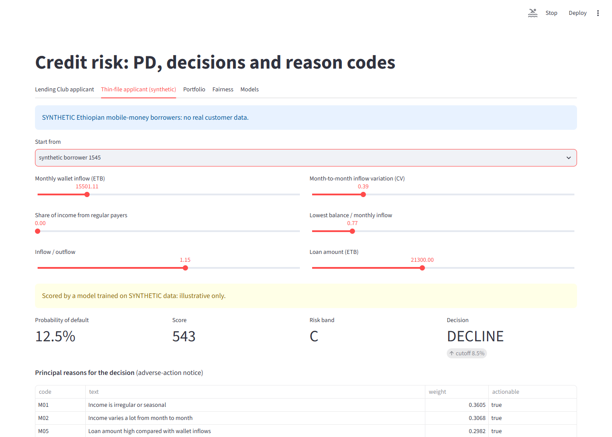
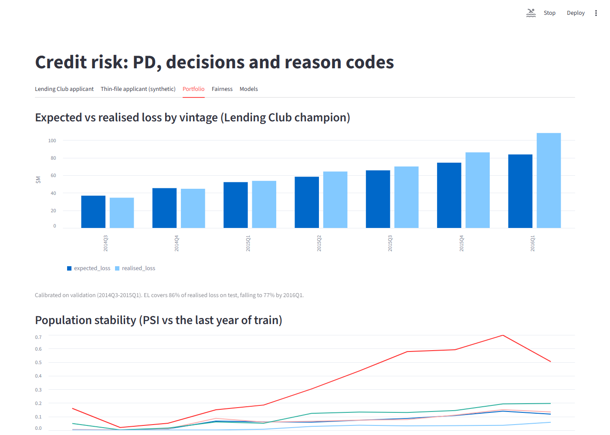
